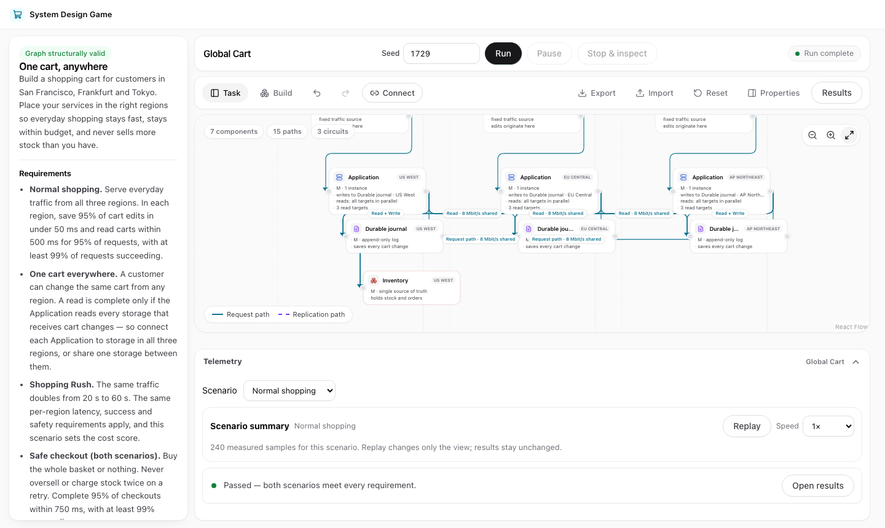
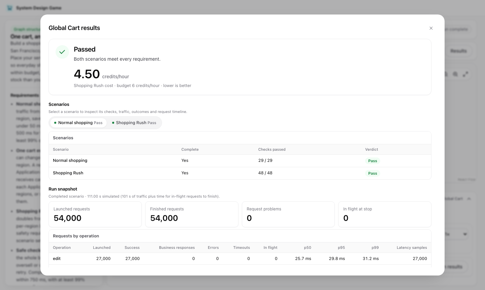

# System Design Game

A browser game about system design. You place services in three regions, connect
them, run a simulated load and try to meet the requirements at the lowest cost.

**Play:** https://albedoweb.github.io/system-design-game/



## The level: Global Cart

Build a shopping cart for customers in San Francisco, Frankfurt and Tokyo.

- Add an Application in each region, storage for carts (a Durable journal or a
  Cart store) and one Inventory, then connect them with paths.
- Buy a circuit for every pair of regions that your paths cross.
- Press **Run**. Two scenarios are simulated: Normal shopping, and a Shopping Rush
  in which traffic doubles.
- A design passes when cart changes, reads and checkouts are fast and reliable
  enough in every region and nothing is oversold. Passing designs are ranked by
  hourly cost; lower is better.

When a design does not pass, the report shows which checks failed and which
component or circuit was overloaded, with the measured queue wait.



Nothing is saved automatically and no account or server is needed. Use
**Export** and **Import** to keep a design as a file.

## Run it locally

Requires Node.js 24 (see `.node-version`).

```bash
npm ci
npm run dev       # http://127.0.0.1:5178
npm run build     # type-check and build into dist/
npm run test:fast # quick unit and component tests (about a minute; what CI runs)
npm test          # everything, including the long engine suites (several minutes)
```

## How it is built

React and TypeScript with Vite; the canvas is React Flow, editor state is
Zustand, and the simulation is a deterministic discrete-event model that runs in
a Web Worker. The same seed and design always produce the same result.

## License

[MIT](LICENSE)
